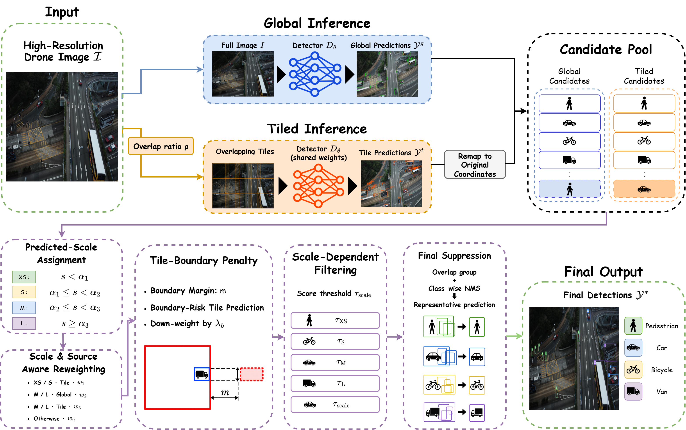

# SATTA: scale-resolved evaluation of tiled inference

Minimal evaluation code for **A Scale-Resolved Evaluation of Tiled Inference for Small-Object Detection in Drone Imagery**.

This toolkit evaluates detector predictions by object size and exposes the false-positive/recall trade-off of tiled inference. It includes the SATTA selection rule, size-bin definitions, XS metrics, FP/FN taxonomy, configuration, and synthetic examples. Evaluating final detections needs **Python 3.10+ and NumPy only**; detector training code, model weights, datasets, and inference services are not required.



## Quick start

```bash
python -m pip install -r requirements.txt
python evaluate.py --pred examples/predictions.json --gt examples/gt.json --taxonomy --per-image --out outputs/example.json
python -m unittest discover -s tests -v
```

The synthetic example contains three images, including one with no GT objects. Its exact counts are **TP=2, FP=2, FN=1**; XS recall is **0.5**, band-specific XS precision is **0.5**, and FP/image is **2/3**. It is an input-format and evaluator check, not a benchmark result.

For your detector, supply predictions and annotations in the [documented JSON formats](docs/INPUT_FORMAT.md):

```bash
python evaluate.py --pred predictions.json --gt gt.json --taxonomy --num-classes 10 --out outputs/evaluation.json
```

`--pred` evaluates all supplied detections without additional thresholding. Missing prediction records for a GT image mean no detections; unknown prediction image names are rejected. Ground truth defines the complete image universe. Images with no objects must remain in it so that FP/image is meaningful.

## What is measured

- Recall across ten size bands in original-image pixels, using `sqrt(width * height)`.
- XS recall, precision and AP at the chosen matching IoU. **XS means GT size <=16 px**. Matched predictions inherit GT size; unmatched predictions use predicted size.
- TP, FP and FN, FP/image, FP/GT, precision, recall, and false discovery rate `FP/(TP+FP)`.
- Separately labelled `*_allFP` XS diagnostics that charge every FP to the XS pool.
- Optional ordered FP/FN taxonomy and per-image counts.
- `legacy_AP50` and `legacy_AP50_95`, preserving the historical repository's custom AP calculation.

**The default protocol is strict, not the native VisDrone evaluation protocol.** It has no ignored-region, crowd, or category-11 exemption. The aggregate legacy AP is **not official COCOeval or VisDrone-devkit AP**. Its absolute values must not be compared with official benchmark numbers as if they used the same evaluator. See [metric definitions](docs/METRICS.md) and [taxonomy rules](docs/TAXONOMY.md).

The JSON report includes the matching policy, configuration, input and source hashes, and runtime versions. Undefined empty-band recall is exported as JSON `null`. When `--iou` differs from 0.5, scale AP is named `XS_AP_at_match_iou`; the aggregate `legacy_AP50` still uses IoU 0.5.

## Optional SATTA and SAHI candidate selection

For already-computed global and tiled detections, install the optional dependencies and use safe candidate JSON:

```bash
python -m pip install -r requirements-merge.txt
python evaluate.py --candidates examples/candidates.json --gt examples/gt.json --methods Global SAHI SATTA --satta-cfg configs/default.json --taxonomy --out outputs/selection.json
```

No detector runs here. Candidate boxes must already be mapped to original-image coordinates, and each tile prediction needs its normalized in-tile center. The selection uses no ground-truth size. SAHI merging calls the SAHI library's class-wise NMS with IoU 0.5; SATTA uses Torchvision class-wise NMS after score adjustment. The core metrics stay available without either dependency.

The shared [SATTA configuration](configs/default.json) and [full equations and settings](docs/CONFIGURATION.md) are included. Detector-specific validation calibration is a separate experiment, not this shared preset. Pickle caches are deliberately not accepted by this public CLI; export their numeric content to the documented JSON schema in a trusted environment.

## Reproduction scope

This release supports reproducible **evaluation of supplied detections** and **selection from supplied candidates**. It does not reconstruct lost checkpoint histories or establish that every printed value in an earlier manuscript used this exact evaluator. Exact historical absolute numbers require the original predictions, GT preprocessing, and checkpoint/environment records. Training and data downloads are outside this minimal release.

The tested local stack is Python 3.14.4, NumPy 2.4.6, and, for optional merging, PyTorch 2.11.0, Torchvision 0.26.0 and SAHI 0.12.8. The core CLI and tests were also checked in a fresh environment containing only NumPy 2.5.4. The CI workflow is configured to test the NumPy-only interface on Python 3.11/3.12. GPU builds should be selected for the target machine; all supplied examples can run on CPU.

## Repository map

| File | Purpose |
|---|---|
| `evaluate.py` | Portable CLI for metrics, optional taxonomy, and candidate selection |
| `satta/metrics.py` | Size bands, matching, XS metrics, legacy AP, taxonomy, transitions |
| `satta/satta.py` | SATTA configuration and score/selection equations |
| `satta/baselines.py` | Global filtering and optional SAHI-library merge |
| `satta/io.py` | Strict JSON input validation and portable output |
| `configs/default.json` | Complete shared preset |
| `docs/` | Input, metric, taxonomy, and configuration definitions |
| `examples/` | Small synthetic inputs; no real images or benchmark annotations |
| `tests/` | Matching, boundary, denominator, CLI, and configuration regressions |

Code licensing and figure/third-party attribution are described in [LICENSE](LICENSE) and [assets/NOTICE.md](assets/NOTICE.md).
